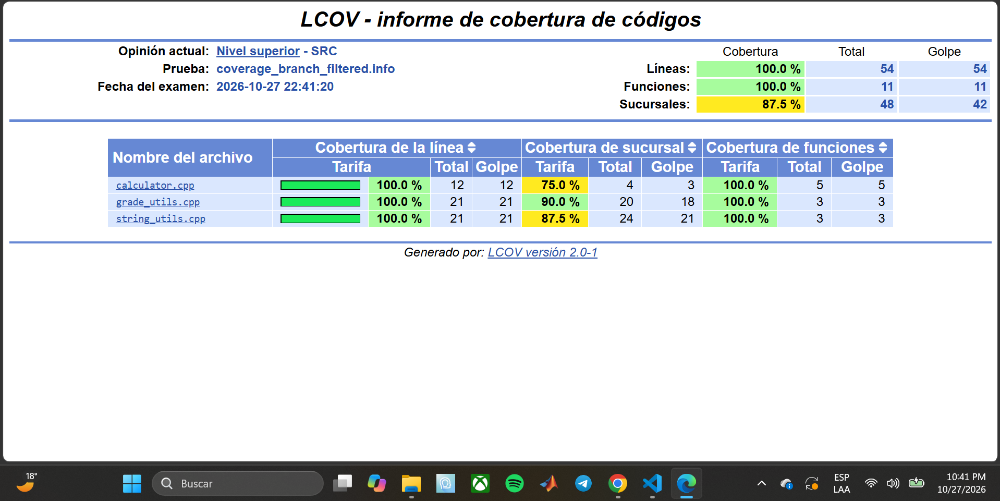

# Parte 8: cobertura de código

## Qué se hizo

Se compiló el proyecto con la opción `ENABLE_COVERAGE=ON`, se ejecutaron las 41 pruebas y se generó un reporte de cobertura con `lcov` y `genhtml`, midiendo líneas, funciones y ramas.

## Qué es cobertura de código

La cobertura de código es una métrica que indica qué partes del código se ejecutaron mientras corrían las pruebas. Se puede medir por líneas (cuáles líneas se ejecutaron), por funciones (cuáles funciones se llamaron) y por ramas (cuáles caminos de cada decisión, como un `if`, se recorrieron). Sirve para encontrar código que ninguna prueba ejecuta.

## Comandos utilizados

```bash
cd ~/laboratorio-testing
rm -rf build
mkdir build
cd build
cmake -DENABLE_COVERAGE=ON ..
make
./run_tests
lcov --capture --directory . --output-file coverage_branch.info --rc branch_coverage=1 --ignore-errors mismatch
lcov --remove coverage_branch.info '/usr/*' '*/_deps/*' '*/tests/*' --output-file coverage_branch_filtered.info --rc branch_coverage=1 --ignore-errors unused
genhtml coverage_branch_filtered.info --rc branch_coverage=1 --output-directory coverage_report
```

`cmake -DENABLE_COVERAGE=ON ..` agrega las banderas `--coverage -O0 -g`, que hacen que el programa registre qué líneas ejecuta. `lcov --capture` lee esos registros, `lcov --remove` descarta los archivos del sistema, de Google Test y de las pruebas para dejar solo el código del proyecto, y `genhtml` genera el reporte HTML en `build/coverage_report/index.html`. La opción `--rc branch_coverage=1` activa la medición de ramas, que `lcov` 2.0 no hace por defecto.

## Error encontrado y cómo se corrigió

Con los comandos del enunciado, `lcov --capture` falló:

```text
geninfo: ERROR: mismatched end line for _ZN43StringUtilsTest_ConvertTextToUppercase_Test8TestBodyEv at /home/sirley/laboratorio-testing/tests/test_string_utils.cpp:4: 4 -> 6
lcov: ERROR: no valid records found in tracefile coverage.info
genhtml: ERROR: cannot read file coverage_filtered.info!
```

`lcov` 2.0 (la versión de Ubuntu 24.04) se confunde con las funciones que genera la macro `TEST(...)` de Google Test, porque el compilador reporta un final de función distinto al esperado. Como `geninfo` abortó, `coverage.info` quedó vacío y los comandos siguientes fallaron en cadena. No era un problema del código ni de las pruebas, que seguían pasando. Se corrigió agregando `--ignore-errors mismatch` al comando `lcov --capture`, y `--ignore-errors unused` al `lcov --remove`.

## Porcentaje de cobertura obtenido

| Archivo | Líneas | Funciones | Ramas |
|---|---|---|---|
| `src/calculator.cpp` | 100% (12 de 12) | 100% (5 de 5) | 75% (3 de 4) |
| `src/grade_utils.cpp` | 100% (21 de 21) | 100% (3 de 3) | 90% (18 de 20) |
| `src/string_utils.cpp` | 100% (21 de 21) | 100% (3 de 3) | 87.5% (21 de 24) |
| **Total** | **100% (54 de 54)** | **100% (11 de 11)** | **87.5% (42 de 48)** |

Salida de `lcov --summary`:

```text
Summary coverage rate:
  lines......: 100.0% (54 of 54 lines)
  functions..: 100.0% (11 of 11 functions)
  branches...: 87.5% (42 of 48 branches)
```

Datos crudos del archivo `coverage_branch_filtered.info` (`FNF`/`FNH`: funciones totales y ejecutadas, `LF`/`LH`: líneas, `BRF`/`BRH`: ramas):

```text
SF:/home/sirley/laboratorio-testing/src/calculator.cpp
FNF:5
FNH:5
BRF:4
BRH:3
LF:12
LH:12
SF:/home/sirley/laboratorio-testing/src/grade_utils.cpp
FNF:3
FNH:3
BRF:20
BRH:18
LF:21
LH:21
SF:/home/sirley/laboratorio-testing/src/string_utils.cpp
FNF:3
FNH:3
BRF:24
BRH:21
LF:21
LH:21
```

## Archivos con mayor y menor cobertura

Por líneas y funciones los tres archivos tienen 100%. Por ramas, el de mayor cobertura es `grade_utils.cpp` (90%) y el de menor es `calculator.cpp` (75%), seguido de `string_utils.cpp` (87.5%).

## Líneas o ramas no cubiertas

No hay líneas ni funciones sin cubrir. Quedaron 6 ramas sin ejecutar (las que `lcov` reporta con taken igual a `0` en el archivo `.info`):

```text
--- Ramas no ejecutadas (BRDA: línea, bloque, rama, veces tomada) ---
SF:/home/sirley/laboratorio-testing/src/calculator.cpp
BRDA:18,e0,1,0
SF:/home/sirley/laboratorio-testing/src/grade_utils.cpp
BRDA:6,e0,1,0
BRDA:24,e0,1,0
SF:/home/sirley/laboratorio-testing/src/string_utils.cpp
BRDA:20,e0,1,0
BRDA:24,e0,1,0
BRDA:25,e0,1,0
```

Código en esas líneas:

```text
calculator.cpp:18:        throw std::invalid_argument("No se puede dividir entre cero");
grade_utils.cpp:6:        throw std::invalid_argument("La lista de notas no puede estar vacía");
grade_utils.cpp:24:        throw std::invalid_argument("La nota debe estar entre 0 y 100");
string_utils.cpp:20:            normalized += static_cast<char>(std::tolower(static_cast<unsigned char>(c)));
string_utils.cpp:24:    std::string reversed = normalized;
string_utils.cpp:25:    std::reverse(reversed.begin(), reversed.end());
```

Todas son ramas con bloque `e0`, que `lcov` usa para los caminos de excepción que el compilador genera alrededor de operaciones que podrían lanzar un error, como construir un `std::invalid_argument` o crear y copiar un `std::string` (por ejemplo, un `std::bad_alloc` si no hay memoria). Ninguna es una decisión de la lógica del programa: los `if`, los rangos de `letter_grade`, el vector vacío y la división entre cero sí están cubiertos. Con pruebas normales no se pueden recorrer estos caminos porque habría que simular que el sistema se queda sin memoria.

## Evidencia del reporte HTML

El reporte está en `build/coverage_report/index.html`. Muestra 100% de líneas (54 de 54), 100% de funciones (11 de 11) y 87.5% de ramas (42 de 48), con el desglose por archivo de la tabla anterior.

## Pruebas adicionales que podrían mejorar la cobertura

Como las líneas y funciones ya están al 100%, estas pruebas no cambian el porcentaje de líneas, pero amplían lo que se verifica:

| Prueba propuesta | Qué verifica | Efecto en la cobertura |
|---|---|---|
| `count_vowels("AEIOU")` debe dar `5` | Que las vocales en mayúscula también se cuentan (hoy solo se prueba en minúscula) | No cambia el porcentaje; verifica una entrada no probada |
| `average` con un solo elemento, por ejemplo `{70}` debe dar `70.0` | El caso mínimo válido del promedio | No cambia el porcentaje; verifica un caso borde que falta |
| Simular un fallo de memoria (por ejemplo, reemplazando `operator new` para que lance `std::bad_alloc`) y comprobar que la función propaga la excepción | Los caminos de excepción `e0` | Es la única forma de subir las ramas del 87.5% hacia 100%, pero es complejo y queda fuera del alcance de este laboratorio |

## Preguntas de reflexión

**1. ¿Qué significa tener 100% de cobertura?**
Que cada elemento medido (línea, función o rama, según la métrica) se ejecutó al menos una vez durante las pruebas. Aquí hay 100% de líneas y funciones, pero solo 87.5% de ramas, así que "100%" depende de qué se esté midiendo.

**2. ¿Tener 100% de cobertura garantiza que el programa no tiene errores?**
No. Solo dice que el código se ejecutó, no que se verificó que el resultado fuera correcto ni que se probaron todas las entradas posibles. Por ejemplo, una prueba podría llamar a `letter_grade(95)` sin ninguna aserción, y la línea contaría como cubierta aunque nada se haya comprobado.

**3. ¿Qué diferencia hay entre cobertura de líneas y cobertura de ramas?**
La de líneas cuenta si cada línea se ejecutó. La de ramas cuenta si se recorrió cada camino posible de cada decisión (el caso verdadero y el falso de un `if`, cada condición de un `||`). Una línea con un `if` puede ejecutarse sin que se pruebe uno de sus dos caminos. Por eso aquí las líneas llegan a 100% y las ramas a 87.5%.

**4. ¿Por qué una línea ejecutada no necesariamente significa que fue bien probada?**
Porque ejecutar una línea no es lo mismo que comprobar su resultado. Una prueba puede pasar por el código sin una aserción útil, o verificar un solo valor entre muchos posibles. La cobertura mide ejecución, no calidad de las verificaciones.

**5. ¿Cómo puede ayudar la cobertura a mejorar las pruebas?**
Señala qué código no está ejecutando ninguna prueba, para decidir qué caso falta. Aquí mostró que todas las decisiones de la lógica están cubiertas y que lo pendiente son caminos de excepción difíciles de provocar, y ayuda a decidir si vale la pena cubrirlos.


