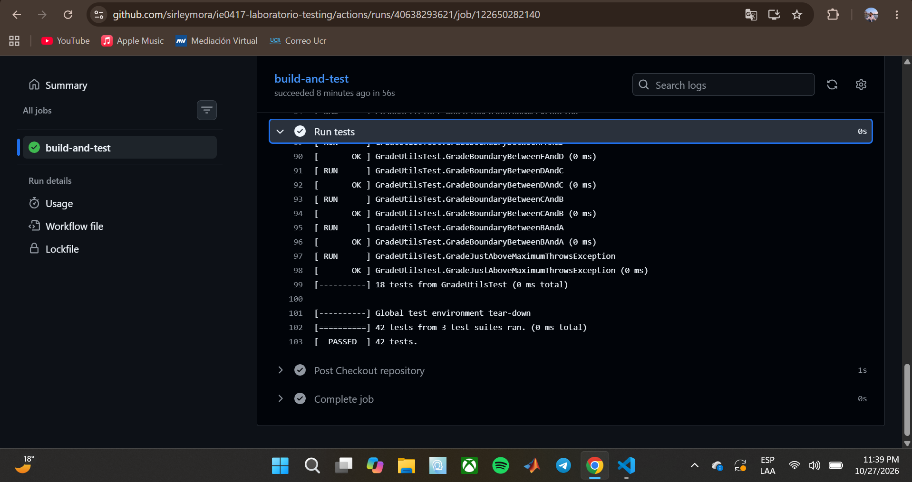

# Parte 10: integración continua con GitHub Actions

## Qué se hizo

Se creó el workflow `.github/workflows/testing.yml` para que las pruebas se compilen y ejecuten automáticamente en GitHub cada vez que se sube código. El proyecto se subió a un repositorio propio, `laboratorio-testing` es la raíz del repositorio, y por eso el workflow no necesita ningún `cd laboratorio-testing`.

Comandos usados para subir el proyecto:

```bash
git init -b main
git add .
git commit -m "Agrega laboratorio de testing con Google Test"
git remote add origin https://github.com/sirleymora/ie0417-laboratorio-testing.git
git push -u origin main
```

Se agregó un archivo `.gitignore` con `build/` para no subir la carpeta de compilación.

## Qué es integración continua

La integración continua (CI) es una práctica en la que cada cambio que se sube al repositorio dispara una compilación y una ejecución de pruebas automáticas en un servidor. Así se detecta rápido si un cambio rompe algo, antes de que llegue a la rama principal o a otras personas del equipo.

## Qué hace el archivo `testing.yml`

Describe un trabajo (`build-and-test`) que corre en una máquina virtual con Ubuntu (`ubuntu-latest`). GitHub crea esa máquina, descarga el código, instala las herramientas, compila el proyecto y ejecuta las pruebas. Si algún paso devuelve error, el trabajo se marca como fallido.

## En qué eventos se ejecuta el workflow

- Cuando se hace `push` a la rama `main`.
- Cuando se abre o actualiza un `pull request` hacia `main`.

## Qué pasos ejecuta el workflow

| Paso | Qué hace |
|---|---|
| `Checkout repository` | Descarga el código del repositorio a la máquina virtual (`actions/checkout@v4`) |
| `Install dependencies` | Instala `build-essential`, `cmake` y `lcov` con `apt` |
| `Configure CMake` | Crea la carpeta `build` y ejecuta `cmake ..`, que también descarga Google Test |
| `Build` | Compila con `make` |
| `Run tests` | Ejecuta `./run_tests` |

## Evidencia del workflow exitoso

La primera ejecución (`C++ testing #1`, commit `2c6601b`, rama `main`) terminó con check verde en 1 minuto. El paso `Run tests` ejecutó las 42 pruebas y todas pasaron.



## Qué pasaría si una prueba falla en GitHub Actions

`./run_tests` termina con un código de error distinto de cero, el paso `Run tests` se marca como fallido, el trabajo completo queda con una X roja y GitHub lo muestra en la pestaña Actions y junto al commit. Si el cambio viene de un `pull request`, el fallo aparece ahí y avisa que no se debe integrar. Esto se comprueba en la sección "Fallo intencional en CI" más abajo.

## Preguntas de reflexión

**1. ¿Por qué es útil ejecutar pruebas automáticamente en GitHub?**
Porque las pruebas se ejecutan siempre, aunque la persona se olvide de correrlas, y en un ambiente limpio. Así se detectan errores que en la computadora local no aparecen, como una dependencia que solo estaba instalada ahí.

**2. ¿Qué problema resuelve la integración continua?**
Evita que un cambio que rompe el proyecto pase desapercibido y se mezcle con el trabajo de otras personas. Los problemas se descubren al subir el cambio, cuando es más fácil identificarlos y corregirlos.

**3. ¿Por qué conviene ejecutar pruebas antes de integrar cambios?**
Porque es más barato corregir un error antes de que llegue a la rama principal que después, cuando otras personas ya trabajaron encima de ese código.

**4. ¿Qué información proporciona GitHub Actions cuando un workflow falla?**
Muestra qué paso falló, el registro completo de la salida de ese paso (con el mensaje de error o el reporte de Google Test), el commit que lo causó, quién lo subió y cuánto tardó.

**5. ¿Cómo ayuda CI a mejorar la colaboración en equipo?**
Da una verificación común e imparcial para todos: un cambio con el check verde cumple lo mínimo acordado, y uno con X roja se corrige antes de revisarlo. Todos ven el mismo resultado, y se reducen los conflictos y las sorpresas al integrar.
