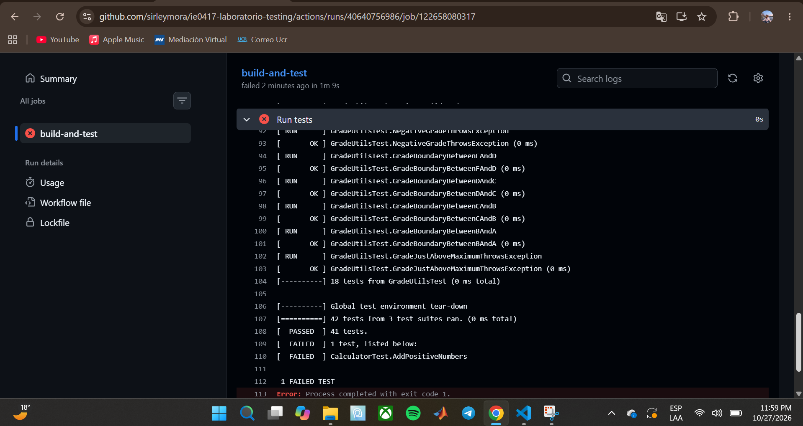
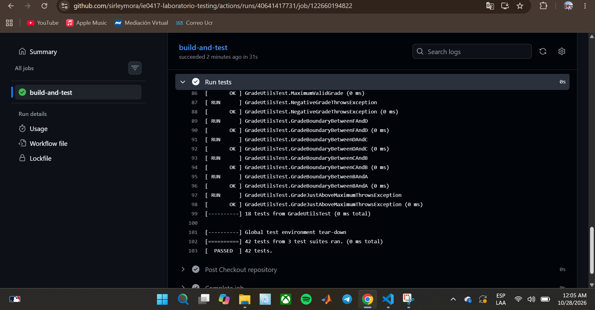

# Parte 10: integración continua con GitHub Actions

## Qué se hizo

Se creó el workflow `.github/workflows/testing.yml` para que las pruebas se compilen y ejecuten automáticamente en GitHub cada vez que se sube código. El proyecto se subió a un repositorio propio, `laboratorio-testing` es la raíz del repositorio, y por eso el workflow no necesita ningún `cd laboratorio-testing`.

Comandos usados para subir el proyecto:

```bash
git init -b main
git add .
git commit -m "Agrega laboratorio de testing con Google Test"
git remote add origin https://github.com/sirleymora/ie0417-laboratorio-testing.git
git push -u origin main
```

Se agregó un archivo `.gitignore` con `build/` para no subir la carpeta de compilación.

## Qué es integración continua

La integración continua (CI) es una práctica en la que cada cambio que se sube al repositorio dispara una compilación y una ejecución de pruebas automáticas en un servidor. Así se detecta rápido si un cambio rompe algo, antes de que llegue a la rama principal o a otras personas del equipo.

## Qué hace el archivo `testing.yml`

Describe un trabajo (`build-and-test`) que corre en una máquina virtual con Ubuntu (`ubuntu-latest`). GitHub crea esa máquina, descarga el código, instala las herramientas, compila el proyecto y ejecuta las pruebas. Si algún paso devuelve error, el trabajo se marca como fallido.

## En qué eventos se ejecuta el workflow

- Cuando se hace `push` a la rama `main`.
- Cuando se abre o actualiza un `pull request` hacia `main`.

## Qué pasos ejecuta el workflow

| Paso | Qué hace |
|---|---|
| `Checkout repository` | Descarga el código del repositorio a la máquina virtual (`actions/checkout@v4`) |
| `Install dependencies` | Instala `build-essential`, `cmake` y `lcov` con `apt` |
| `Configure CMake` | Crea la carpeta `build` y ejecuta `cmake ..`, que también descarga Google Test |
| `Build` | Compila con `make` |
| `Run tests` | Ejecuta `./run_tests` |

## Evidencia del workflow exitoso

La primera ejecución (`C++ testing #1`, commit `2c6601b`, rama `main`) terminó con check verde en 1 minuto. El paso `Run tests` ejecutó las 42 pruebas y todas pasaron.


## Qué pasaría si una prueba falla en GitHub Actions

`./run_tests` termina con un código de error distinto de cero, el paso `Run tests` se marca como fallido, el trabajo completo queda con una X roja y GitHub lo muestra en la pestaña Actions y junto al commit. Si el cambio viene de un `pull request`, el fallo aparece ahí y avisa que no se debe integrar. Esto se comprueba en la sección "Fallo intencional en CI" más abajo.

## Preguntas de reflexión

**1. ¿Por qué es útil ejecutar pruebas automáticamente en GitHub?**
Porque las pruebas se ejecutan siempre, aunque la persona se olvide de correrlas, y en un ambiente limpio. Así se detectan errores que en la computadora local no aparecen, como una dependencia que solo estaba instalada ahí.

**2. ¿Qué problema resuelve la integración continua?**
Evita que un cambio que rompe el proyecto pase desapercibido y se mezcle con el trabajo de otras personas. Los problemas se descubren al subir el cambio, cuando es más fácil identificarlos y corregirlos.

**3. ¿Por qué conviene ejecutar pruebas antes de integrar cambios?**
Porque es más barato corregir un error antes de que llegue a la rama principal que después, cuando otras personas ya trabajaron encima de ese código.

**4. ¿Qué información proporciona GitHub Actions cuando un workflow falla?**
Muestra qué paso falló, el registro completo de la salida de ese paso (con el mensaje de error o el reporte de Google Test), el commit que lo causó, quién lo subió y cuánto tardó.

**5. ¿Cómo ayuda CI a mejorar la colaboración en equipo?**
Da una verificación común e imparcial para todos: un cambio con el check verde cumple lo mínimo acordado, y uno con X roja se corrige antes de revisarlo. Todos ven el mismo resultado, y se reducen los conflictos y las sorpresas al integrar.

---

## Fallo intencional en CI

### Qué cambio se hizo para provocar el fallo

En `tests/test_calculator.cpp`, línea 6, se cambió el valor esperado de la prueba `AddPositiveNumbers` de `5` a `999`:

```cpp
EXPECT_EQ(add(2, 3), 999);
```

```bash
sed -i 's/EXPECT_EQ(add(2, 3), 5);/EXPECT_EQ(add(2, 3), 999);/' tests/test_calculator.cpp
```

### Qué pasó localmente

Se compiló con `make` y se ejecutó `./run_tests`. La prueba `AddPositiveNumbers` falló y las otras 41 pasaron:

```text
[ RUN      ] CalculatorTest.AddPositiveNumbers
/home/sirley/laboratorio-testing/tests/test_calculator.cpp:6: Failure
Expected equality of these values:
  add(2, 3)
    Which is: 5
  999
[  FAILED  ] CalculatorTest.AddPositiveNumbers (0 ms)
[==========] 42 tests from 3 test suites ran. (2 ms total)
[  PASSED  ] 41 tests.
[  FAILED  ] 1 test, listed below:
[  FAILED  ] CalculatorTest.AddPositiveNumbers

 1 FAILED TEST
```

Google Test indica el archivo y la línea del fallo (`test_calculator.cpp:6`), el valor que se esperaba (`999`) y el que se obtuvo (`5`, el resultado real de `add(2, 3)`).

### Qué pasó en GitHub Actions

Se subió el cambio con `git add .`, `git commit -m "Introduce fallo intencional en prueba"` y `git push` (commit `629dc00`). El workflow `C++ testing` se ejecutó automáticamente y terminó con una X roja: el job `build-and-test` falló después de 1 minuto y 9 segundos. Los pasos de instalar, configurar y compilar terminaron bien, porque las pruebas llegaron a ejecutarse, y el que falló fue `Run tests`.

### Qué mensaje mostró el workflow

El registro del paso `Run tests` terminó así:

```text
[==========] 42 tests from 3 test suites ran. (0 ms total)
[  PASSED  ] 41 tests.
[  FAILED  ] 1 test, listed below:
[  FAILED  ] CalculatorTest.AddPositiveNumbers

 1 FAILED TEST
Error: Process completed with exit code 1.
```

`./run_tests` devolvió el código de salida `1` porque una prueba falló, y por eso GitHub Actions marcó el paso y el job como fallidos.



### Cómo se corrigió

Se devolvió el valor esperado a `5`, se recompiló y se verificó localmente antes de subir:

```bash
sed -i 's/EXPECT_EQ(add(2, 3), 999);/EXPECT_EQ(add(2, 3), 5);/' tests/test_calculator.cpp
cd build
make
./run_tests
cd ..
git add .
git commit -m "Corrige prueba fallida"
git push
```

Resultado local después de corregir:

```text
[----------] Global test environment tear-down
[==========] 42 tests from 3 test suites ran. (3 ms total)
[  PASSED  ] 42 tests.
```

### Evidencia del workflow exitoso después de corregir

La corrección se subió en el commit `bbe71b9` y el workflow volvió a salir con check verde, con las 42 pruebas pasando:



### Preguntas de reflexión

**1. ¿Por qué es útil ver una prueba fallar al menos una vez?**
Porque confirma que la prueba realmente puede detectar un error. Una prueba que nunca se ha visto fallar podría estar mal escrita y pasar siempre sin comprobar nada. También permite aprender a leer el mensaje de error y entender qué información muestra.

**2. ¿Qué diferencia hay entre una prueba fallando localmente y una prueba fallando en CI?**
Localmente el fallo lo ve solo quien ejecuta las pruebas, y se puede corregir antes de subir el código. En CI el fallo queda registrado en GitHub, visible para todo el equipo, junto al commit que lo causó, y se ejecuta en un ambiente limpio y distinto de la computadora de cada persona.

**3. ¿Por qué no se debería dejar código con pruebas fallidas en la rama principal?**
Porque la rama principal debe estar siempre en un estado funcional. Si tiene pruebas fallidas, cualquier persona que parta de ahí hereda el error, no se puede saber si un fallo nuevo es del cambio actual o del anterior, y se pierde la confianza en el resultado de las pruebas.

**4. ¿Qué aporta CI a la calidad del software?**
Verifica cada cambio de forma automática y con las mismas condiciones, detecta errores en cuanto se introducen, evita que código roto se integre sin que nadie lo note y deja un historial de qué cambios pasaron o fallaron las pruebas.
